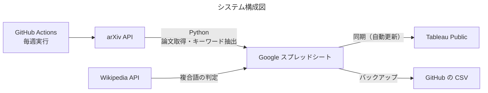

# TableauとGithub Actionを使ったarXivキーワードトレンドの可視化

arXivに投稿された「スポーツ × AI・機械学習」関連の論文タイトルからキーワードを抽出し、研究の傾向をTableauで可視化するプロジェクト。

**Tableau Public： [URL](https://public.tableau.com/app/profile/hatsuho.saito/viz/AI_17916936350290/1)**

## 目的

- 論文の発表傾向を把握する
  - どんなAI技術やモダリティ（映像、センサー、音声など）の研究が盛んか
  - どんな競技・種目の研究が進んでいるか
- Tableauを使えるようになる（データ接続、アクション、フィルター、ダッシュボード作成、公開）

## 概要



- arXiv APIで論文を取得（クエリ条件は下記）。
- 論文タイトルから名詞を抽出し、出現頻度をTableauで可視化。
- 新しく発表された論文を反映するため、GitHub Actionsで定期的に最新の論文を取得し、Googleスプレッドシートに追記。
TableauはスプレッドシートとGoogle Sheets同期でつながっているので、ダッシュボードにも自動で反映。

### arXiv APIのクエリ条件

| 項目 | 条件 |
|---|---|
| カテゴリ | `cs.*`（Computer Science）、`eess.*`（Electrical Engineering and Systems Science）、`stat.*`（Statistics） |
| 検索語 | `sports`、`sport`、`athlete`、`athletes`、`athletic` |
| 検索対象 | タイトル（`ti:`）または要旨（`abs:`） |
| 期間 | 2021年1月1日以降の投稿日（`submittedDate`） |

実際のクエリは次の形です（月ごとに期間を区切って取得）。

```
(cat:cs.* OR cat:eess.* OR cat:stat.*)
AND (ti:sports OR abs:sports OR ti:sport OR abs:sport OR ... OR ti:athletic OR abs:athletic)
AND submittedDate:[202101010000 TO 202101312359]
```
※要旨は検索対象だが出現頻度のカウントには利用していない

## Tableauで見られること

- 2021年以降/直近1年のキーワードの出現数（年ごとに色分け）
- キーワードをクリックすると、そのキーワードを含む論文の一覧に移動します
- 論文のタイトルをクリックすると、arXivの論文ページが開きます
<!-- - arXivカテゴリ（cs.CV、cs.LGなど）ごとの論文数 -->

## 検証したこと

### 1. タイトルのみを対象にし、除外語の一覧を作成

初めは要旨も出現頻度カウント対象にしたが、event、issueなど、傾向の把握に関係のない語が多く抽出されたため、タイトルのみを対象にした。

それでも重要性の低い単語を除くため、2021年以降の論文から100件をランダムに選び、タイトルから抽出された語を次の基準で判定して、除外語の一覧（`stop_words.txt`）を作成。
手作業で思いついた語を並べるのではなく、ランダムに選んだ論文に同じ基準を当てはめることで、選び方の偏りを減らしています。

**stopwordには入れない**

1. 競技名・種目名、大会やリーグの名前（例：soccer、ice hockey、NBA、FIFA world cup）
2. 機械学習・AIの手法、タスク、モデルの名前（例：reinforcement learning、pose estimation、LLM）
3. データのモダリティ（例：video、camera、EEG、trajectory、3d、drone）
4. 意味を判断できない略語（手法やデータセットの名前の可能性があるため）

**stopwordに入れる**

- 上記以外の語（例：event、issue、approach、study、analysis）
- 検索語（sports、sport、athlete など）

結果、ランダムに選んだ100件から抽出された367語のうち、263語を除外語とした。

### 2. Wikipediaを使った複合語の判定

spaCyで単語に分けると、「machine learning」が「machine」と「learning」に分かれるなど、2語以上で1つの意味になる語が分割されてしまうことが多くあった。  
念のためspaCyのモデル（small、medium、large）でも比較したが、名詞句の区切り方に大きな違いはなかったため、軽量なsmallモデルとWikipediaを組み合わせる以下の方法を採用。

1. spaCyの名詞句（noun_chunks）を取り出す
2. 名詞句の中で、Wikipediaのタイトルと一致する単語は複数単語であっても1語として残す（Wikipedia APIを利用/リダイレクトも記事も含む）
   - 例：「machine learning approach」→「machine learning」は記事があるので1語として残し、「approach」は別の1語とする
3. 残りの部分は、名詞・固有名詞の単語に分ける
4. 表記ゆれをそろえる（例：large language model → LLM）
5. レマタイズ後、stopwordの一覧にある語を除く

「どの語を複合語とするか」を自分で決めるのではなく、Wikipediaに記事として存在するかという外部の基準で決めることで、判断に一貫性を持たせた。Wikipediaで見つかった語は `wiki_terms.txt` に保存。


### 3. arXiv APIのエラーへの対応

arXiv APIからの定期取得では、429（リクエストが多すぎる）、503、タイムアウトなどのエラーがたびたび発生。公式に原因は発表されていませんが、混み合っていることが原因と考えられるため、失敗を前提に次の対策を実施。

- エラー時は待ち時間を延ばしながら再試行する（30秒、60秒、120秒…）
- GitHub Actionsでは、失敗したら20分後にもう一度実行する（経験上15分ほど時間をおくと成功することが多かったため）
- 週2回のデータ取得では直近7日分を取得し、前回失敗していても取りこぼしがないよう対応（既にある論文は除いて追記する）

## データ

| シート / CSV | 列 | 内容 |
|---|---|---|
| papers | paper_id, title, abstract, published, category, categories, url | 論文1件につき1行 |
| keywords | paper_id, year, keyword, count | 論文とキーワードの組み合わせ1つにつき1行 |
| paper_categories | paper_id, category, is_primary | 論文とarXivカテゴリの組み合わせ1つにつき1行 |

## ファイル構成

| ファイル | 内容 |
|---|---|
| `arxiv_api_title.py` | 論文の取得とキーワード抽出。2021年以降の論文を月ごとにまとめて取得する |
| `update_daily.py` | 定期実行用。直近7日分を取得し、新しい論文だけをスプレッドシートに追記してCSVを更新する |
| `upload_to_sheets.py` | CSVの内容でスプレッドシートを丸ごと書き換える（初回のアップロード用） |
| `rebuild_keywords.py` | キーワード抽出の方法を変えたとき、`papers.csv` から `keywords.csv` を作り直す |
| `stopwords_sample.txt` | 除外語の一覧 |
| `wiki_terms.txt` | Wikipediaに記事があった語のキャッシュ |
| `.github/workflows/update.yml` | GitHub Actionsの設定|
| `papers.csv` など | スプレッドシートのバックアップ |

## 実行方法

```bash
pip install -r requirements.txt
python -m spacy download en_core_web_sm

# 環境変数
export GCP_SA_KEY_FILE=/path/to/service_account.json   # サービスアカウントの認証キー
export SPREADSHEET_ID=xxxxxxxx                          # スプレッドシートのID

python arxiv_api_title_withwiki.py    # 初回：2021年以降の論文を取得してCSVに保存
python upload_to_sheets.py   # CSVをスプレッドシートにアップロード
python update_daily.py       # 以降の更新（GitHub Actionsから実行）
```